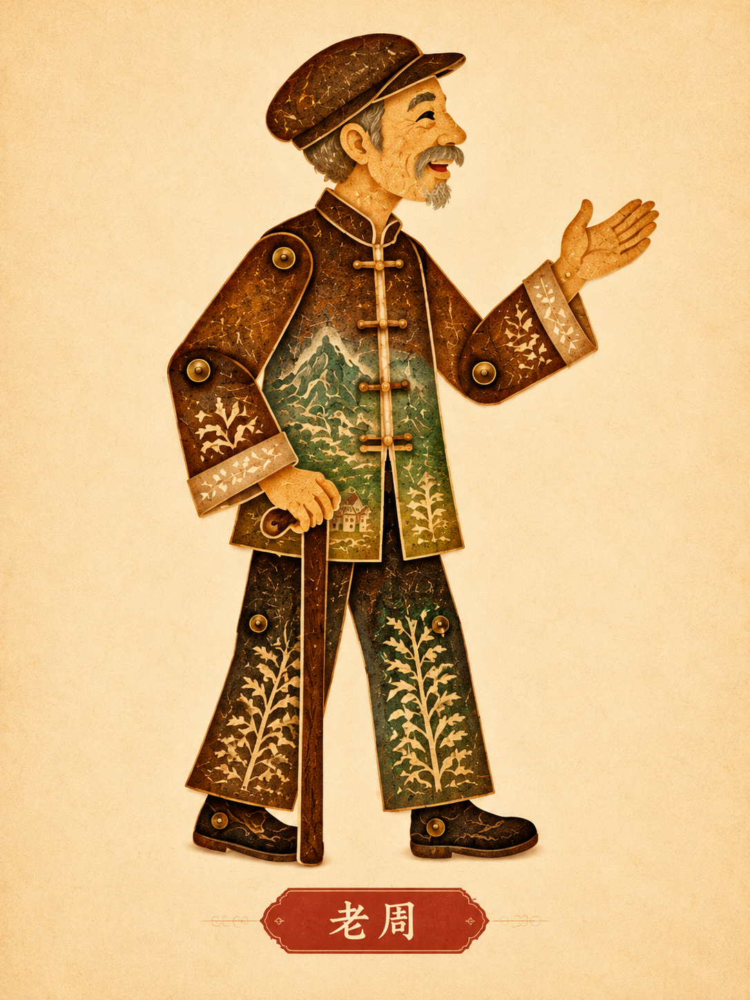
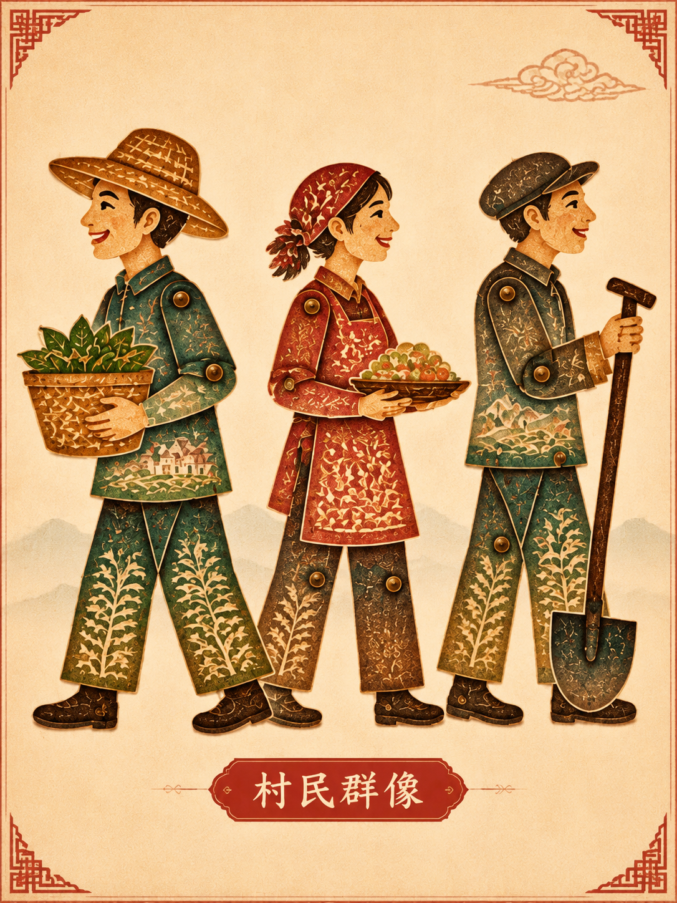

# 《山河有约》

——从绿水青山到金山银山

以浙江省湖州市安吉县余村的发展转型为背景，讲述老村民老周与返乡大学生、孙女小禾通过交流、观察和实践理解生态保护与绿色发展的故事。老周、小禾及其家庭经历为艺术化虚构的综合创作，不冒充真实历史人物或亲历史料。制作方向为中国传统皮影戏、剪纸艺术与代码驱动的现代MG动画。

项目主题：推进生态文明建设。核心观点包括绿水青山就是金山银山、人与自然和谐共生、生态保护与经济发展协同、推动绿色发展，让绿色成为高质量发展的鲜明底色。

**第一至三幕Scene01—Scene12已完成视觉Demo并分别导出，共140秒；其余12镜待制作。** 当前为字幕与原创环境音版本，尚未录制人物对白。Word脚本及三张原始人物模板保留；正式全片仍为300秒、六幕／24镜、1920×1080、16:9、30fps、9000帧。5秒TechnicalPreview继续仅用于初始化检查，不计入正片。

## 项目资料

- [第一幕制作交接与12张关键帧](docs/act01/README.md) · [媒体验证记录](docs/act01/verification.json)
- [第二幕制作交接与12张关键帧](docs/act02/README.md) · [第二幕媒体验证](docs/act02/verification.json)
- [第三幕制作报告与12张关键帧](docs/act03/README.md) · [第三幕媒体验证](docs/act03/verification.json)
- [前三幕视频与字幕](videos/README.md) · [发布与接手说明](docs/发布与接手说明.md) · [文件校验清单](videos/manifest.json)
- [主Word视频脚本](docs/视频脚本/推进生态文明建设_余村故事线视频脚本.docx) · [创作源码与分镜数据](docs/视频脚本/源码/README.md) · [来源哈希](docs/视频脚本/来源记录.json)
- [人物设定与视觉规范](docs/人物设定与视觉规范.md) · [人物素材清单、来源及校验](red-paper-reborn/public/assets/characters/README.md)
- [项目背景与制作规范](docs/项目背景与制作规范.md) · [史实与参考资料](docs/史实与参考资料.md)
- [24镜分工与进度](docs/分镜与制作进度.md) · [迁移报告](docs/migration/迁移报告.md) · [清理清单](docs/migration/清理清单.md)
- [团队接手](docs/HANDOFF.md) · [美术规范](red-paper-reborn/STYLE_GUIDE.md) · [进度](PROGRESS.md)

## 前三幕视频

|幕|镜头／时长|MP4|字幕|制作说明|
|---|---|---|---|---|
|一：山河旧貌|Scene01–04／40秒|[观看或下载](videos/act01/Act01Demo.mp4)|[SRT](videos/act01/Act01Demo.srt)|[交接及12帧](docs/act01/README.md)|
|二：发展的抉择|Scene05–08／50秒|[观看或下载](videos/act02/Act02Demo.mp4)|[本幕](videos/act02/Act02Demo.srt)／[全片时间](videos/act02/Act02Demo-global.srt)|[交接及12帧](docs/act02/README.md)|
|三：理念的转变|Scene09–12／50秒|[观看或下载](videos/act03/Act03Demo.mp4)|[本幕](videos/act03/Act03Demo.srt)／[全片时间](videos/act03/Act03Demo-global.srt)|[报告及12帧](docs/act03/README.md)|

以上均为1080p／30fps、含原文字幕和原创环境音的视觉Demo，真人录音待制作。当前发布状态和队友运行步骤见[发布与接手说明](docs/发布与接手说明.md)；各幕制作记录保留当时状态，以本页和总进度为当前依据。

## 人物素材库与后续动画制作规范

2026-10-31已完整阅读正式Word的九部分、六幕24镜及全部声音定稿，并将三张用户提供的原始PNG按字节复制入库。三图均1086×1448，RGB无透明通道；保留宣纸背景、装饰、人物名称、原始纹理和比例，没有重绘、裁切、去背景或拆骨骼。

| 小禾 | 老周 | 余村村民群像 |
| --- | --- | --- |
|  |  |  |
| [xiaohe.png](red-paper-reborn/public/assets/characters/xiaohe.png) · 2.72 MiB | [laozhou.png](red-paper-reborn/public/assets/characters/laozhou.png) · 2.65 MiB | [yucun_villagers_group.png](red-paper-reborn/public/assets/characters/yucun_villagers_group.png) · 2.90 MiB |

以上文件均位于 `red-paper-reborn/public/assets/characters/`，不在仓库根部重复建库。群像保留三位成人的整体参考属性，没有拆成三个独立角色。**当前版本为人物视觉设定模板，正式骨骼动画使用前可能需要进一步分层。**

后续所有镜头必须先检查[人物设定与视觉规范](docs/人物设定与视觉规范.md)、素材库和对应Word分镜，统一引用此库，禁止为了某个镜头重新设计小禾或老周。原图不可覆盖；动作、朝向、脚本需要的道具和原风格内表情应在后续衍生文件中处理，不能拉伸整张PNG假装弯臂。

脚本与模板的差异已列明：小禾在剧情中使用手机、帆布包，原图是相机、棕色双肩包；老周现图戴帽扶拐杖，但各镜帽子状态按脚本，不能据拐杖编造经历。原始模板没有中年版、儿童或独立关节图层；前两幕采用的SVG衍生实现与限制见下文及各幕交接。早期初始化文档的“人物待设计”是当时状态，当前人物参考进度以本节及人物规范为准；正式字幕与安全区以Word第七部分为准。

人物归档阶段保留了三张完整原图，并核对正式Word与桌面原稿一致。第一幕现已按本次允许的SVG复刻方式建立可动衍生人物：小禾及老周现实／中年版。它们保留模板识别，不是原PNG的逐像素拆层；细节精修和真人配音仍待后续审定，详见第一幕交接。

第二幕继续引用这些人物、老屋与字幕组件，补充依据群像板图的三类简化村民、工作道具及治理／农家乐场景。第三幕继续复用上述内容，新增历史资料、笔记修改与持续修复场景。全片目前12／24镜完成视觉Demo，各幕交接包含动作接口、配音窗口和下一幕接镜位置。

## 旧项目与分支

旧《红纸新生》已在[归档分支](https://github.com/P1chyTT/MaoGai-video/tree/archive/hongzhi-xinsheng)及[版本标签](https://github.com/P1chyTT/MaoGai-video/tree/hongzhi-xinsheng-final)保存；队友后续配音和第五幕工程另见[协作快照](https://github.com/P1chyTT/MaoGai-video/tree/archive/hongzhi-xinsheng-collaboration)。第四、第五幕还有各自归档，详见迁移报告。

新项目开发分支为 [project/shanhe-youyue](https://github.com/P1chyTT/MaoGai-video/tree/project/shanhe-youyue)，迁移审阅见 [PR #3](https://github.com/P1chyTT/MaoGai-video/pull/3)。原默认分支 `master` 保持原样，只有经用户确认合并迁移PR后才切换项目首页。本次不删除历史、不强推、不合并旧成员分支。

## 技术与目录

沿用React 19.2.3、TypeScript 5.9.3、Remotion 4.0.537、SVG与透明PNG技术。保留锁定依赖，不新增付费生成接口。`red-paper-reborn/`是保留的历史工程路径，包名与所有当前入口已经改为山河有约，保留路径是为了减少CI和渲染脚本的迁移风险。

```text
docs/
  视频脚本/                 # 主稿、已确认收录的创作文件及来源
  人物设定与视觉规范.md      # 爷孙关系、24镜人物需求、模板差异及引用约束
  项目背景与制作规范.md
  史实与参考资料.md
  分镜与制作进度.md
  migration/               # 备份、清理清单、迁移记录
red-paper-reborn/
  src/shared/              # 宣纸舞台、帧缓动、字体、字幕
  src/components/          # 镜头、分层山水、独立主题条
  src/scenes/act01–act06/   # act01–act03共十二镜已实现，其余待制作
  src/compositions/        # Act01Demo、Act02Demo、Act03Demo及TechnicalPreview
  src/components/act01/    # 共享皮影人物、矿山、窗桌、道具
  src/components/act02/    # 村民、工具包、纸带、溪岸与农家乐道具
  src/components/act03/    # 历史资料、笔记、推杯与分区修复
  public/assets/           # 新角色、矿山/村庄/山水、竹林/河流等目录
    characters/            # xiaohe.png、laozhou.png、yucun_villagers_group.png
  scripts/                 # 导出和完整性检查
  out/                     # 本机生成，全部忽略
```

## 安装、预览和导出检查

Node.js 22.13+或24+。在新电脑上：

```sh
git clone --branch project/shanhe-youyue https://github.com/P1chyTT/MaoGai-video.git
cd MaoGai-video/red-paper-reborn
pnpm install --frozen-lockfile --config.node-linker=hoisted
pnpm run dev
```

也可使用 `npm install`；仓库CI使用已锁定的pnpm流程。首次下载浏览器需要联网。

```sh
pnpm run lint
pnpm run check:project
pnpm run check:portable
pnpm run check:act01
pnpm run keyframes:act01
pnpm run render:act01
pnpm run check:act02
pnpm run keyframes:act02
pnpm run render:act02
pnpm run check:act03
pnpm run keyframes:act03
pnpm run render:act03
pnpm run keyframes
pnpm run render
```

Studio选择 `Act01Demo`：40秒／1200帧，地址通常为 `http://localhost:3000/Act01Demo`；四个独立镜头也可单独预览。正式第一幕使用 `render:act01`／`keyframes:act01`，输出 `out/act01/Act01Demo.mp4`、`Act01Demo.srt`和12张关键帧。

第二幕选择`Act02Demo`：[预览入口](http://localhost:3000/Act02Demo)，50秒／1500帧。`render:act02`／`keyframes:act02`输出`out/act02/Act02Demo.mp4`及12张关键帧；`check:act02`生成独立幕和全片时间两份SRT。第二幕局部从0秒计时，全片组装时整幕从40秒进入，避免重复加偏移。正式配音尚待录制，镜头动作、复用接口与下幕接镜见第二幕交接。

第三幕选择`Act03Demo`：[预览入口](http://localhost:3000/Act03Demo)，50秒／1500帧，四镜为12／13／12／13秒。`render:act03`／`keyframes:act03`输出`out/act03/Act03Demo.mp4`及12张关键帧；`check:act03`生成两种时间轴SRT。全片组装时整幕从90秒进入。历史资料与现实人物分层，没有领导人肖像、模仿声音或现场复原；原文、素材接口及第四幕接镜见第三幕制作报告。

`TechnicalPreview`仍为5秒／150帧。旧的 `render`、`keyframes`及Windows `render-demo.cmd`继续只导出初始化检查，不会输出五分钟影片。`preview.cmd`继续启动Studio。

参考资料以[核验清单](docs/史实与参考资料.md)中列出的国家发展改革委、国家林草局、文化和旅游部、生态环境部及央视等权威页面为准；发布年份与事件年份分别记录，不将虚构家庭故事当作史实。不引用未经核验的收入、游客或碳排放统计。

五分钟整片尚未制作。前三幕发布版MP4与字幕已纳入本分支`videos/act01/`、`videos/act02/`、`videos/act03/`，校验见清单；代码、原创环境音及36张首中末帧一并交付。工程仍将重新渲染输出到本地`out/`，该目录及渲染缓存继续被Git忽略。后续更新视频先核对大小，超过50MiB时检查Git LFS配额／权限或使用GitHub Releases，不提交渲染缓存。
