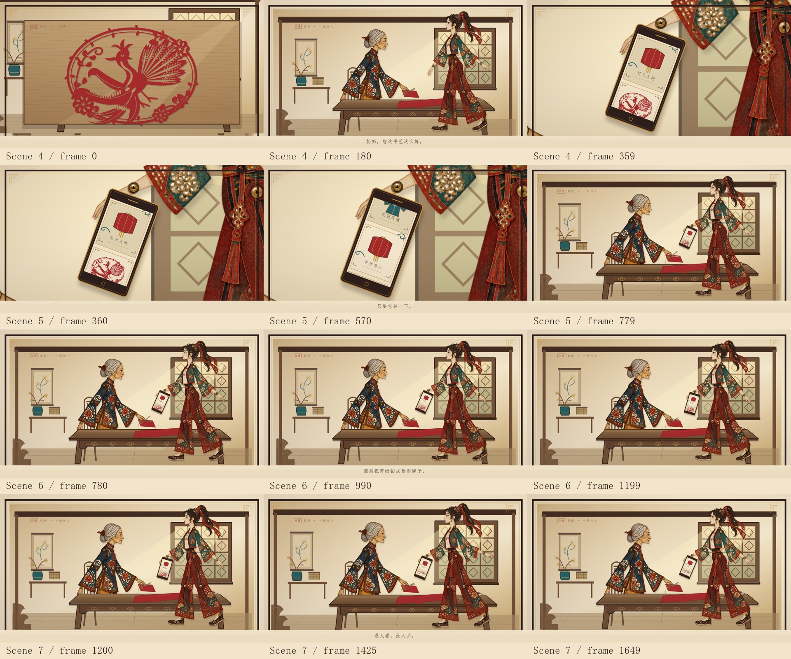
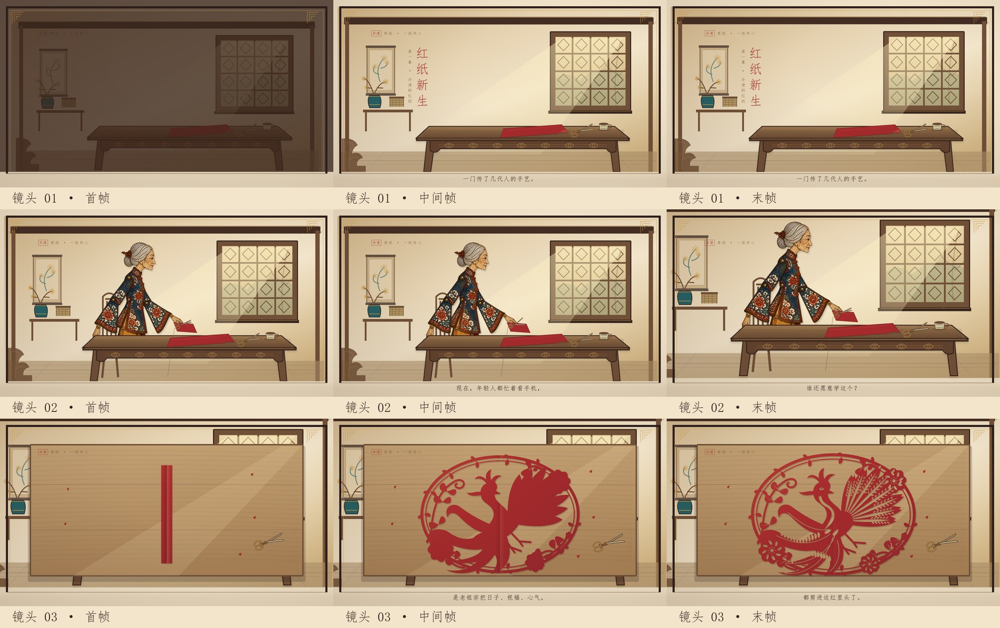

# 《红纸新生》｜皮影戏 MG 动画协作仓库

<<<<<<< HEAD
**最新进度（2026年10月24日）**：为目前所有动画完成语音。  ——EH.

**进度(2026年10月23日23点54分)**：添加scenes I语音。——EH.

**进度（2026-10-23）：第二幕 Scene04–07 动作增强版已完成，55秒／1650帧。** 小林增加点头、前倾、前臂手势和随手移动的手机，奶奶增加停剪后的抬头与回应。当前仍为无声视觉Demo，待团队审片；第一幕基线继续保留。
=======
**最新进度（2026-10-25）：第六幕“真正的破圈”视觉成片完成，20秒／600帧、1920×1080、30fps。** 手工特写、小林认真拍摄、原青年体验剪纸、两代展示双凤新作，以及逐层展开的青绿山河画卷均已实现。含原文字幕、无音轨；600帧完整解码和末秒稳定停留检查通过。

[第六幕MP4](red-paper-reborn/out/Act06Demo.mp4) · [12帧首中末总览](red-paper-reborn/out/act06/storyboard.jpg) · [动作细节](red-paper-reborn/out/act06/motion-details.jpg) · [制作与复用指南](red-paper-reborn/ACT06_GUIDE.md) · [核验记录](red-paper-reborn/out/act06/verification.json)。Studio选择 `Act06Demo` 或Scene21–24；运行 `npm run keyframes:act06`、`npm run render:act06`。

**全片仍待整合：** 六幕均已有独立视觉视频；第四幕队友版和第五幕视频仍在各自PR中，第五幕源码未交接，一、二幕配音在独立分支、尚未合入。本次不改动这些分支。现有六幕顺接参考为261秒／4分21秒，不是已交付的完整混音版。第六幕20秒原文较密，正式配音前需复核时长，不能把静音字幕版作为自然语速配音验收。

**第四幕版本记录（2026-10-24）：已确认队友上传第四幕；本地制作的第四幕列为“备选版”。** 两个版本均保留，等待团队审片决定；队友的 `act04` 分支和合并请求未作修改。

|第四幕版本|查看位置|当前状态|
|---|---|---|
|队友已上传版|[act04分支视频](https://github.com/P1chyTT/MaoGai-video/blob/act04/Act04Demo.mp4) · [合并请求 #1](https://github.com/P1chyTT/MaoGai-video/pull/1)|作者september-5，提交85afac9；尚未合入master|
|你的版本（备选版）|[Act04Demo-Alternate.mp4](red-paper-reborn/out/Act04Demo-Alternate.mp4) · [首中末总览](red-paper-reborn/out/act04/storyboard.jpg) · [制作与复用说明](red-paper-reborn/ACT04_GUIDE.md)|50秒／1500帧、1080p／30fps；含字幕、无音轨，检查通过|

备选版包含商品蒙太奇、三条评论、数据上涨与人物沉默的反差、重复印花与手工镂空凤凰对比。Studio的 `Act04Alternate` 文件夹收录备选版；为兼容既有链接，技术入口仍叫 `Act04Demo` 和 Scene13–16。`npm run render:act04` 只输出 `out/Act04Demo-Alternate.mp4`。[版本关系与接手说明](docs/ACT04_VERSIONS.md)。另已发现队友的 [act05分支](https://github.com/P1chyTT/MaoGai-video/tree/act05)／[合并请求 #2](https://github.com/P1chyTT/MaoGai-video/pull/2)，内容尚待团队审阅。
>>>>>>> origin/master

**最新进度（2026-10-24）：第三幕 Scene08–12 已完成，60秒／1800帧，1920×1080、30fps。** 新增电脑合作邀请、商家入场、9.9元价格印章、小林劝说，以及奶奶以原图分层前臂放下剪刀的动作。完整导出、1800帧解码、字幕及三位人物素材校验通过；仍为带字幕的无声视觉Demo，待团队审片。

[第三幕完整视频](red-paper-reborn/out/Act03Demo.mp4) · [关键帧总览](red-paper-reborn/out/act03/storyboard.jpg) · [制作与复用说明](red-paper-reborn/ACT03_GUIDE.md) · [核验记录](red-paper-reborn/out/act03/verification.json)

**第二幕里程碑（2026-10-23）：Scene04–07 动作增强版已完成，55秒／1650帧。** 小林增加点头、前倾、前臂手势和随手移动的手机，奶奶增加停剪后的抬头与回应。第一、二幕独立入口和既有输出继续保留。

[观看／下载第二幕动作增强版](red-paper-reborn/out/Act02Demo-Motion.mp4) · [第二幕制作与复用说明](red-paper-reborn/ACT02_GUIDE.md) · [前一版视频对照](red-paper-reborn/out/act02/Act02Demo-before-motion.mp4)



以传统彩色皮影、剪纸和宣纸幕布为视觉标准，使用 React + TypeScript + Remotion 制作非遗剪纸文化传承短片。

**第一幕基线（2026-10-21）：前三镜视觉 Demo 已完成；全片尚未完成。** 第一幕样片长36秒、1920×1080、30 fps、1080帧，含对白字幕，暂无配音、音效和配乐。该版本可供分镜、美术、动画和声音成员接续制作，视觉规范待团队审阅确认。



## 先看这些

|内容|位置|
|---|---|
|第六幕20秒最终幕视觉成片|[视频](red-paper-reborn/out/Act06Demo.mp4) · [24张高清关键帧](red-paper-reborn/out/act06/keyframes) · [制作指南](red-paper-reborn/ACT06_GUIDE.md)|
|第四幕（备选版）完整交付|[50秒视频](red-paper-reborn/out/Act04Demo-Alternate.mp4) · [23张关键帧](red-paper-reborn/out/act04/keyframes) · [核验记录](red-paper-reborn/out/act04/verification.json)|
|60秒第三幕完整样片|[观看／下载 Act03Demo.mp4](red-paper-reborn/out/Act03Demo.mp4)|
|第三幕25张关键帧与动作总览|[首／中／末总览](red-paper-reborn/out/act03/storyboard.jpg) · [动作细节](red-paper-reborn/out/act03/motion-details.jpg) · [高清帧图](red-paper-reborn/out/act03/keyframes)|
|第三幕规范、接口与验证|[制作与复用说明](red-paper-reborn/ACT03_GUIDE.md) · [核验记录](red-paper-reborn/out/act03/verification.json)|
|55秒第二幕动作增强版|[观看／下载 Act02Demo-Motion.mp4](red-paper-reborn/out/Act02Demo-Motion.mp4)|
|第二幕关键帧与参数核验|[关键帧](red-paper-reborn/out/act02/keyframes) · [检查记录](red-paper-reborn/out/act02/verification.json)|
|36秒 MP4 样片|[观看／下载 Act01Demo.mp4](red-paper-reborn/out/Act01Demo.mp4)|
|三个镜头首、中、末帧|[关键帧目录](red-paper-reborn/out/keyframes)|
|实际输出与检查结果|[QA_REPORT](red-paper-reborn/QA_REPORT.md) · [参数记录](red-paper-reborn/out/verification.json)|
|项目进度、已知限制、待办|[PROGRESS](PROGRESS.md)|
|配色、比例、纹理、阴影、机位、组件接口|[STYLE_GUIDE](red-paper-reborn/STYLE_GUIDE.md)|
|队友安装、预览、导出、接手流程|[接手指南](docs/HANDOFF.md)|
|分镜范围与后续任务|[制作分工建议](docs/PRODUCTION_PLAN.md)|
|完整故事脚本原稿|[在线阅读](docs/script/SCRIPT.md) · [Word原稿](docs/script/视频脚本_原稿.docx)|
|提交与验收规范|[CONTRIBUTING](CONTRIBUTING.md)|

## 在新电脑上运行

需要 Node.js 20.19+、22.13+ 或24+，首次安装和首次下载渲染浏览器需要联网。

```sh
git clone https://github.com/P1chyTT/MaoGai-video.git
cd MaoGai-video/red-paper-reborn
npm install
npm run dev
```

打开终端显示的本地地址，选择 **Act01Demo**、**Act02Demo**、**Act03Demo** 或 **Act06Demo**；第四幕备选版在 **Act04Alternate → Act04Demo**。独立镜头为Scene01–16和Scene21–24；Scene17–20源码尚未交接，不存在对应Studio入口。

```sh
npm run lint       # 代码规范 + TypeScript
npm run keyframes  # 首／中／末帧与凤凰完成帧
npm run render     # 输出 out/Act01Demo.mp4
npm run keyframes:act02  # 第二幕关键帧
npm run render:act02     # 输出 out/Act02Demo.mp4
npm run keyframes:act03  # 第三幕25张关键帧
npm run render:act03     # 输出 out/Act03Demo.mp4
npm run keyframes:act04  # 第四幕备选版23张关键帧
npm run render:act04     # 输出 out/Act04Demo-Alternate.mp4
npm run keyframes:act06  # 第六幕24张关键帧
npm run render:act06     # 输出 out/Act06Demo.mp4
```

已有依赖的 Windows 电脑也可运行工程内 `preview.cmd`、`render-demo.cmd`（后者导出第一幕）。第一幕渲染使用3101端口，第二幕使用3103端口，第三幕使用3106端口，第四幕备选版使用3107端口，第六幕使用3108端口，与Studio分开；运行前保证相应端口可用。

## 工程结构

```text
red-paper-reborn/
  src/
    Act01Demo.tsx           # 240 + 450 + 390 帧的连续时间线
    Act02Demo.tsx           # 360 + 420 + 420 + 450 帧的第二幕
    Act03Demo.tsx           # 270 + 450 + 360 + 300 + 420 帧的第三幕
    Act04Demo.tsx           # 第四幕备选版，300 + 360 + 420 + 420 帧
    Act06Demo.tsx           # 第六幕，120 + 90 + 150 + 240 帧
    Root.tsx                # 总片及独立镜头注册
    scenes/                 # Scene01–16及21–24；Scene13–16为第四幕备选版
    act06/                  # 手艺特写、青年体验、新剪纸与片尾山河画卷
    act04/                  # 备选版工作桌、商品蒙太奇、反馈屏幕、工艺对比
    act03/                  # 第三幕编排、电脑桌、商家、商业道具与字幕
    act02/                  # 第二幕动作参数、小林、手机和字幕
    shared/                 # 舞台、房间、原图人物、剪刀、凤凰、字幕
  public/assets/
    characters/             # 四位原始角色PNG及校验清单
    backgrounds/            # 固定宣纸纹理
    fonts/                  # 可分发宋体与许可
  scripts/                  # 渲染、关键帧、输出核验
  out/                      # 本里程碑样片、关键帧、检查数据
docs/                       # 接手与分工说明
```

第一幕只使用奶奶，四位角色素材已保留。人物未重画；本版为轻微头部动作、坐姿裁切和独立剪刀，没有完整手臂骨骼。凤凰为代码编写的SVG，纹样和展开时序可分别修改。

请先阅读美术规范再制作下一镜。后续镜头复用共享房间和世界坐标；所有动作按帧驱动。原始脚本中的整幕时长与本次36秒样片范围不完全相同，后续总片时间线需在分镜定稿后确认，不直接沿用旧时码。

## 仓库收录范围

保留源代码、依赖锁定文件、角色／纹理、字体许可、MP4、关键帧和协作说明。依赖目录、浏览器缓存、临时渲染包、本机路径和本地交付ZIP不提交。工程及用户提供的角色素材未另行授予开源使用许可；字体按其随附许可使用。
