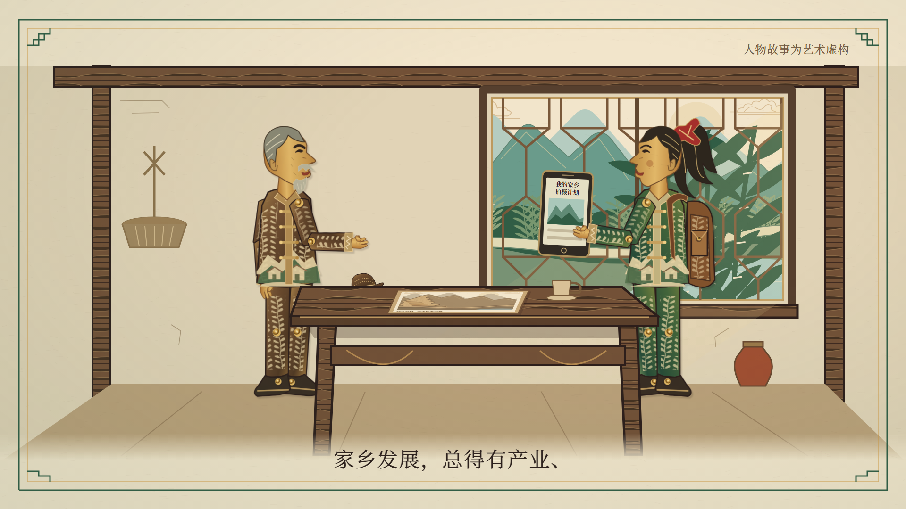

# 第一幕《山河旧貌》制作交接

依据：[正式 Word](../视频脚本/推进生态文明建设_余村故事线视频脚本.docx)第一幕及第六、七部分；角色依据：[人物模板与视觉规范](../人物设定与视觉规范.md)。仅实现 Scene01—Scene04，第二至六幕仍待制作。交付为**字幕＋原创环境音的40秒视觉 Demo**，没有录制或生成老周、小禾人声。

## 时间线与镜头

| 镜头 | 时间／全局帧（右端不含） | 实现内容 |
| --- | --- | --- |
| Scene01 一张旧照片 | 00:00—00:10／[0,300) | 绘制旧图落桌；山体、采挖缺口、运输路逐层出现；纸框退出成舞台；右手压图，中年老周看山，右行矿车接下镜。 |
| Scene02 收入背后的灰尘 | 00:10—00:20／[300,600) | 矿车、水泥袋与收入信封；接信封、笑意收住；两层灰尘覆盖竹叶、局部溪水污染，转至沾灰窗台并关窗。 |
| Scene03 返乡的镜头 | 00:20—00:30／[600,900) | 共用窗框切今日竹林；老周收帽；小禾举手机、滑动，显示山景和两条空白标题栏，再转给爷爷；旧图留在同一桌面。 |
| Scene04 为什么要改 | 00:30—00:40／[900,1200) | 小禾指旧图、抬眼看山，老周点头；同一山体路径分屏呈现采挖与植被结构差别；双手翻图至背面，接下幕纸面。 |

规格：1920×1080、30fps、1200帧、40秒整、H.264／yuv420p／BT.709 MP4、AAC环境音。转场在镜内完成，没有叠化扣时、额外片头或黑场。第1199帧为有意保留的宣纸背面，不是漏渲染。

## 预览、检查和导出

在 `red-paper-reborn/` 执行：

```sh
pnpm run dev
pnpm run lint
pnpm run check:project
pnpm run check:act01
pnpm run keyframes:act01
pnpm run render:act01
```

Studio入口：`http://localhost:3000/Act01Demo`；四镜也分别注册为 Scene01—Scene04。服务器端口以启动打印地址为准。`TechnicalPreview`和原有 `render`／`keyframes` 初始化命令保留；第一幕使用带 `:act01` 的命令。

本地交付：`red-paper-reborn/out/act01/Act01Demo.mp4`、`Act01Demo.srt`、`keyframes/`。`out/`继续忽略，视频未自动纳入 Git；下方12张关键帧另存于本交接目录。媒体实测见[verification.json](verification.json)。

## 四镜首、中、末关键帧

| 镜头 | 首帧 | 中帧 | 末帧 |
| --- | --- | --- | --- |
| 01 | [0](keyframes/Scene01-first.png) | [150](keyframes/Scene01-middle.png) | [299](keyframes/Scene01-last.png) |
| 02 | [300](keyframes/Scene02-first.png) | [450](keyframes/Scene02-middle.png) | [599](keyframes/Scene02-last.png) |
| 03 | [600](keyframes/Scene03-first.png) | [750](keyframes/Scene03-middle.png) | [899](keyframes/Scene03-last.png) |
| 04 | [900](keyframes/Scene04-first.png) | [1050](keyframes/Scene04-middle.png) | [1199](keyframes/Scene04-last.png) |



## 代码和复用接口

| 组件／文件 | 作用 |
| --- | --- |
| `src/compositions/Act01Demo.tsx` | 四个独立Series.Sequence，每镜10×fps帧，不跨镜扣时。 |
| `src/scenes/act01/Scene01.tsx`—`Scene04.tsx` | 各镜帧驱动动作和独立预览。 |
| `src/components/act01/art.tsx` | `RIDGE`和`SCAR`共用山形；`MountainScene(era)`按时代添加采挖台阶或竹林，不只改色；`ArtDefs`提供皮革、藤叶、木纹与铆钉。 |
| `Puppet.tsx` | 模板依据的手绘SVG衍生人物；`variant: elder/middle/xiaohe`、`facing`、`head`、`upper`、`forearm`、`thumb`、表情和道具。`armLayer: body/front/all`允许身体在桌后、手臂在桌前。角度单位为度，x/y/scale为舞台变换。 |
| `StageProps.tsx` | 厂房、矿车、尘带、水泥袋、旧图、老屋与桌子；`OldHouseStage`两时代窗框几何一致，`OldPrint`标注绘制历史示意。 |
| `SceneFrame.tsx` | 复用宣纸舞台、对白字幕、资料标记和分镜音效切片。 |
| `src/shared/ShadowStage.tsx` | 可选formal细框及角纹，保留初始化默认值，边框避让字幕。 |
| `src/shared/Dialogue.tsx` | formal为44px宋体、底部78px、160px字幕承托区；保留原初始化样式。 |
| `src/components/CameraLayer.tsx` | 帧缓动，开放起止缩放、位移、延迟、时长与锚点，默认行为不变。 |
| `captions.json` | 11段真实文本，局部毫秒；检查脚本逐字比对正式稿，并生成全局SRT。 |
| `scripts/render-act01.mjs` | 导出12张首中末帧、额外动作帧或完整MP4；检查1200帧与1080p规格。 |

SVG保留小禾高马尾、红发饰、绿衣、棕包，以及老周侧脸、帽形、棕绿服装和老年须发识别；中年版共用面部结构，减少白发、挺直站立。手机按剧情配置。它们按用户本次允许的SVG复刻方式制作，**不是原PNG逐像素拆层，也不声称恢复全部雕花与皮革细节**。后续可在现有接口精修纹样或替换审定分层件，不能重设角色基础外观。

三张原始PNG未修改，群像本幕未使用。已实现头部、肩肘、手指及分层遮挡；没有完成原PNG精细骨骼拆分、步态库或全套表情资产。美术参考见[STYLE_GUIDE](../../red-paper-reborn/STYLE_GUIDE.md)。

## 声音和录音窗口

无现成本项目人声，未调用TTS或付费接口。`public/assets/audio/act01-foley.wav`为代码制作的原创机械低鸣、车轮轻响、纸张、关窗、鸟鸣和四个轻拨弦音；无下载素材、无模仿人声。生成源为`scripts/create-act01-foley.py`，固定种子、仅Python标准库；48kHz、16bit双声道、40秒，原始峰值约−19.4dBFS，合成内另乘0.7音量。

| 全局窗口 | 说话人 | 原文 |
| --- | --- | --- |
| 00:01.0—00:09.0 | 老周画外音 | 那时候，我们觉得，山里的石头就是财富。 |
| 00:10.5—00:19.5 | 老周画外音 | 矿上有活干，家里有了收入。可灰尘，也落进了日子里。 |
| 00:20.5—00:29.5 | 小禾 | 这次返乡拍片，我想拍个热门。家乡发展，总得有产业、有收入吧？ |
| 00:30.4—00:34.9 | 小禾 | 既然能挣钱，后来为什么要关？ |
| 00:35.2—00:39.5 | 老周 | 挣钱之外，还有一本账。 |

录音后在窗口内微调分句，不改对白、不挤压40秒。当前SRT为脚本时间版，不冒充实录对齐结果；真人录音、音乐统筹和最终混音待后续验收。

## 后续接续

当前视觉与工程产出可供小组观看；人物纹样精度、真人配音及最终艺术审片仍可继续完善。第二幕从第1200帧接宣纸背面，按正式脚本加入2003—2005年时间轴，本次未创建后续镜头。
