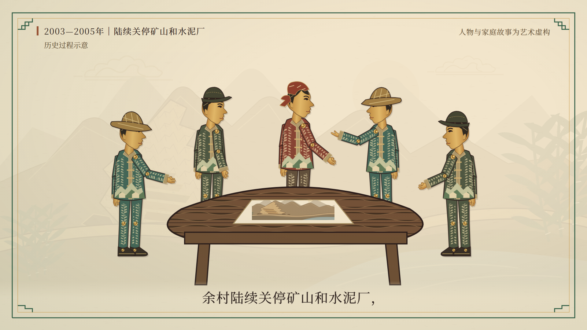
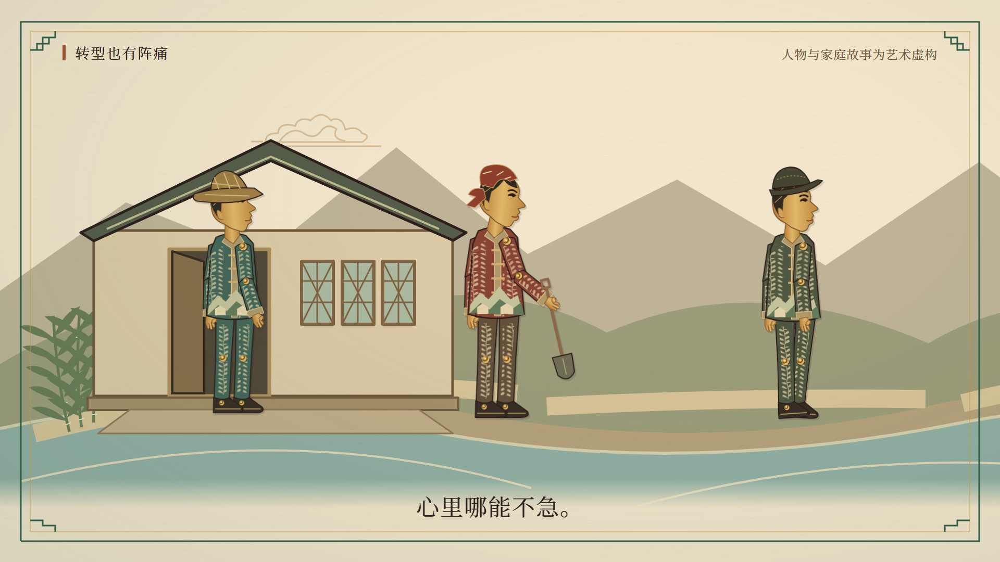
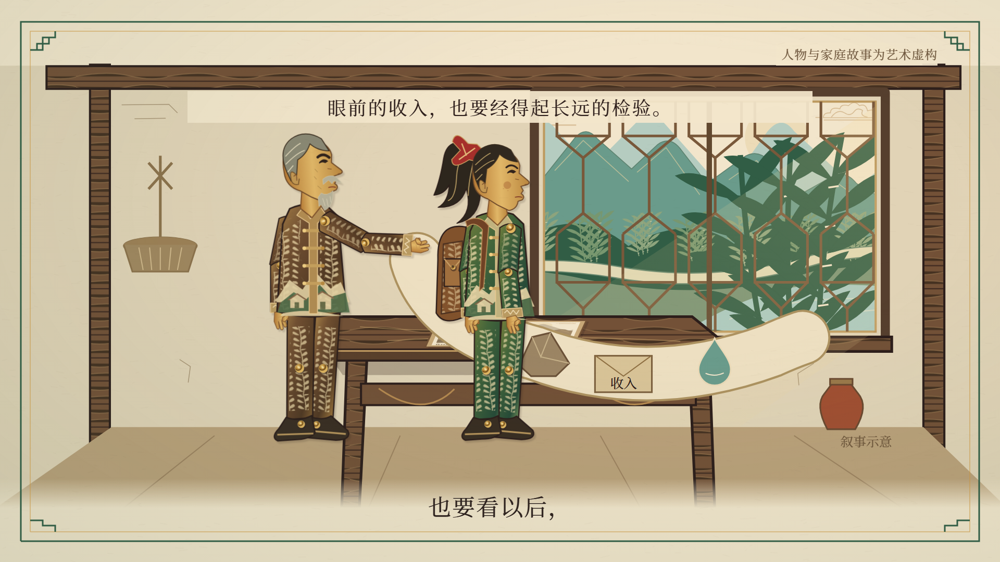
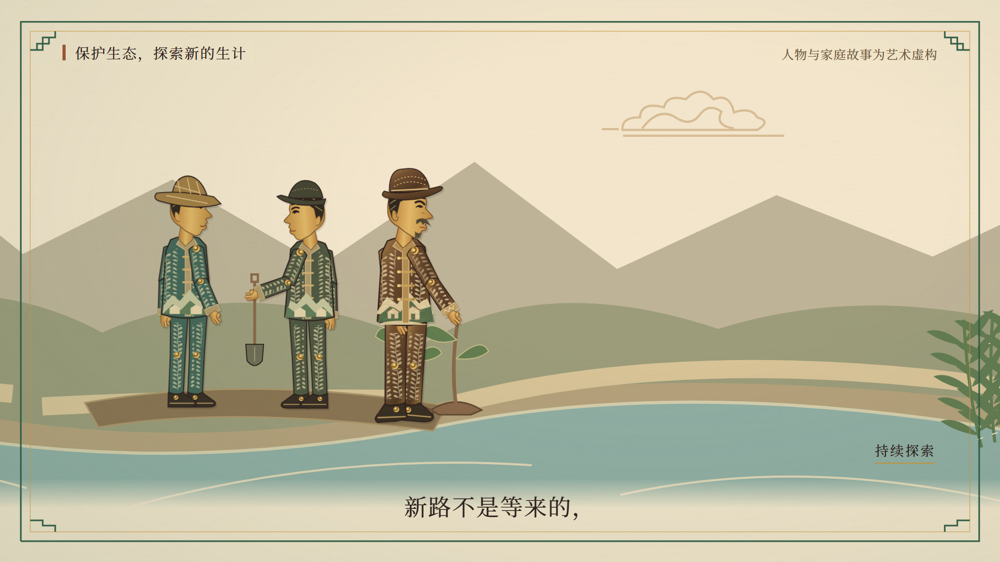
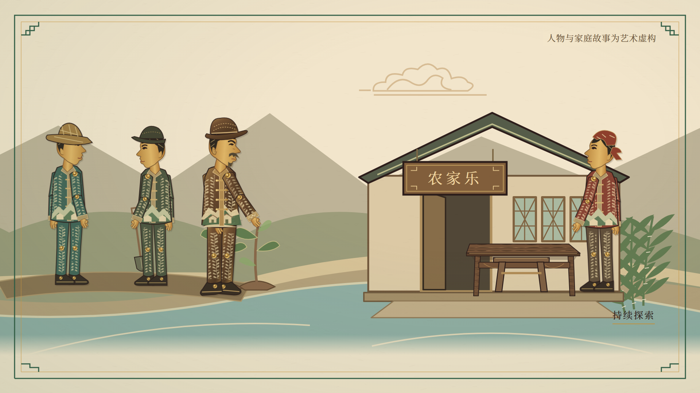

# 第二幕《发展的抉择》制作交接

更新：2026-10-31。本次完成Scene05–Scene08，独立50秒／1500帧／1920×1080／30fps视觉Demo。正式依据为[Word视频脚本](../视频脚本/推进生态文明建设_余村故事线视频脚本.docx)第二幕及声音定稿；[分镜数据](../视频脚本/源码/shots.json)用于逐字和时间窗核对。没有制作第三幕。

已完成代码、Studio预览、H.264 MP4导出、四镜首中末12张关键帧和全片解码检查。目前为完整字幕＋原创环境音版本，没有录制人物配音。不能将视觉Demo等同于最终声音与美术验收。

## 成品与时间轴

本机成品：`red-paper-reborn/out/act02/Act02Demo.mp4`。同目录有独立幕字幕`Act02Demo.srt`和全片时间字幕`Act02Demo-global.srt`。`out/`继续被Git忽略，未提交渲染缓存。视频属性、文件哈希、黑白帧扫描及音频测量见[verification.json](verification.json)。

|镜头|内容|独立幕帧区间|全片帧区间|秒数|
|---|---|---|---|---:|
|Scene05|关停的决定|[0,360)|[1200,1560)|12|
|Scene06|空下来的工具包|[360,720)|[1560,1920)|12|
|Scene07|留给以后|[720,1110)|[1920,2310)|13|
|Scene08|第一批新尝试|[1110,1500)|[2310,2700)|13|

`Act02Demo`使用局部0–50秒，各镜在`Series`内再从0计时。全片组装时将整幕放在第1200帧起；**不要在各镜内部再加40秒**。镜间动作和转场全部计入规定时长。视频轨恰好1500帧／50秒；AAC封装可能带约5毫秒尾部填充，不是新增视频帧。

## 四镜实际完成内容

- Scene05：宣纸承接第一幕，2003—2005年份轴描边；两组齿轮依次减速停止；五名村民围绕山形图讨论，以点头、低头和抬手发问表现犹豫；厂门合拢，中年老周拎工具包，工具收起。末尾切入同一工具包落桌动作。保留“历史过程示意”和人物虚构标记，不虚构投票、正式会议文件或统一关停日。
- Scene06：工具包、工作帽、“生活账”进入桌面；老周放帽后停顿，账本不写金额；三位村民分别观察店面、持农具思考、向村口行走；硬切今日反应，小禾把手机放到膝部，老周抬手引向窗外。手机与前臂在桌前绘制，避免被桌面遮住。
- Scene07：同一屋内窗桌与两人侧影，镜头缓推4%；一条窄宣纸带按石头、收入信封、水、树、儿童生活的村庄次序显现，随后收折为写有“以后”的山水图。纸带是叙事意象；儿童仅为简化场景小剪影，不把成人模板缩小充当儿童。水滴放大覆盖画面接下一镜。
- Scene08：宽幅分层溪岸从左向右巡看；清理三处杂物入袋、扶苗与递工具、挂“农家乐”牌、搬桌整理板凳，最终保留空桌与向村口张望的主人。苗木只增加少量叶片，标注“持续探索”，没有瞬间繁荣或客满。末尾木牌轻微放大，预留Scene09矩形资料卡衔接。

## 代码与复用接口

工程根为`red-paper-reborn/`，沿用React／TypeScript／Remotion锁定依赖。

|文件|职责与复用方式|
|---|---|
|[Act02Demo.tsx](../../red-paper-reborn/src/compositions/Act02Demo.tsx)|按360／360／390／390帧顺序合成|
|[Scene05–Scene08](../../red-paper-reborn/src/scenes/act02/)|四个帧驱动独立镜头与`captions.json`；声音窗口来自正式稿|
|[Act02Frame.tsx](../../red-paper-reborn/src/components/act02/Act02Frame.tsx)|`scene`必填，`label/subline/labelOpacity/fiction`可选；复用`ShadowStage formal`与`Dialogue formal`，按镜头裁取本幕环境音|
|[Villager.tsx](../../red-paper-reborn/src/components/act02/Villager.tsx)|`kind=worker/farmer/woman`，与第一幕骨架尺寸一致；支持朝向、手臂角度、头部、步幅、轻蹲和手持物；不是新增有姓名的角色|
|同上`handPoint()`|输入位置／缩放／朝向／上臂和前臂角度，返回手部舞台坐标，工具递送或绑定道具应使用该函数|
|[Props.tsx](../../red-paper-reborn/src/components/act02/Props.tsx)|工具包、空白账本、厂门、纸带终态、溪岸、农舍、树苗、扫帚、铁锹、木牌和板凳；`PastDesk`与`bagDropY(time)`连接05／06|
|[render-act02.mjs](../../red-paper-reborn/scripts/render-act02.mjs)|导出50秒影片或12张关键帧；`extras`模式可补充动作检查帧|
|[verify-act02.mjs](../../red-paper-reborn/scripts/verify-act02.mjs)|核对四镜时长、原文、配音窗口、单条字幕长度和原有文件哈希；`--write-srt`生成两种时间轴字幕|
|[inspect-act02-media.py](../../red-paper-reborn/scripts/inspect-act02-media.py)|读取实际MP4，完整解码1500帧和音轨、扫描黑白帧、复制12张检查图并写验证记录|

直接复用第一幕的`Puppet`（小禾／现实老周／中年老周）、`OldHouseStage`、`OldTable`、`OldPrint`、`WorkHat`、`Hand`、`Factory`、`MountainScene`、`ArtDefs`和`Phone`，以及共享`CameraLayer`、`ShadowStage`、`Dialogue`、字体及缓动。第一幕组件文件保持原样，没有复制整套人物重新设计。

三张原始PNG逐字节保留；本幕人物仍为第一幕已建立的SVG可动衍生实现，**不是原PNG的精细骨骼拆层**。村民简化轮廓依据原群像的草帽／红头巾／深色帽、绿棕红服饰与植物纹样，用统一铆钉关节。原始板图及约束继续以[人物规范](../人物设定与视觉规范.md)为准。

## 美术与动作补充规范

基础色沿用第一幕：森林绿`#315D45`、山水青`#6A9B8B`、天空蓝`#A8C9C2`、大地棕`#8A6849`、宣纸米黄`#F2E5CB`、传统金`#C79540`、墨褐`#2D1E1B`。05／06通过灰棕器物与空桌表达压力；07／08逐渐加入水、树苗、村庄和劳动，未使用全屏变绿滤镜。

纸纹、边框、暖透光和轮廓沿用共享舞台；图形内部使用原木纹与花草镂空。人物基准约300×795单位，场景缩放约0.58–0.82，桌面特写短时1.25倍。上肢绕肩、肘旋转，工具围绕手部绑定；不拉伸PNG或夸张张嘴。动作由`useCurrentFrame()`及缓动控制，不依赖CSS循环或不受控随机数。

字幕完全使用第一幕`Dialogue formal`：宋体系列、44px、字距2px、墨褐、底部78px、左右120px，底部160px宣纸渐变承托。分12条显示全部原文，分条不改字；当前沿用第一幕整句淡入机制，不另加打字机效果。主题条在画面上方，必要时加轻薄米黄承托以保证与屋梁和人物分离。

05厂门平移120px（低于画宽8%）；07缓推4%；08宽画布横移1140px，以分区遮罩控制治理／种植／经营次序。05→06工具包使用同一连续时间函数；07→08水滴扩大倍率60，修正了上左角旧场景露边。04→05和07→08边界抽样RGB差均不超过3／255，没有可见明暗闪变；它们不是逐像素完全相同的图片。

Scene08末尾木牌中心约舞台`(1248,490)`，终态约1.02倍，矩形大致`x1106–1390 / y445–535`。后续Scene09可从该矩形承接历史资料卡；不要为提前接镜挪动第二幕的空桌停留或延长总时长。本次没有创建Scene09。

## 字幕、配音与声音

没有找到对应录音，已保留正式声音定稿窗口，未伪造声音。独立幕时间如下；全片时间加40秒。

|镜头|说话者|独立幕秒区间|原文|
|---|---|---|---|
|05|旁白|0.5–11.5|二〇〇三年至二〇〇五年，余村陆续关停矿山和水泥厂，开始寻找新路。|
|06|老周|12.5–18.8|活停了，收入少了，心里哪能不急。|
|06|小禾|19.1–23.6|不开矿，村里靠什么生活？|
|07|老周|24.5–36.2|山不能只看眼前能换多少钱，也要看以后，还能给子孙留下些什么。|
|08|旁白|37.5–49.3|清理溪道，复垦复绿，尝试农家乐。新路不是等来的，也没有一开始就走顺。|

`public/assets/audio/act02-foley.wav`为本项目原创程序合成的50秒／48kHz／16bit／双声道环境音，来源为`scripts/create-act02-foley.py`，固定种子20261101。含机械减速、工具包轻落、布料和脚步、两个低弦音、溪流、轻铲土与木牌声，最后约1秒风声；没有下载音效、商业音乐或TTS。源音轨峰值约−21.18dBFS，场景音量0.8，成片测量见验证记录。后续真人录音与最终混音仍需小组完成。

## 启动与复现

在`red-paper-reborn/`中执行已有包管理流程；无需升级依赖：

```sh
pnpm run dev
pnpm run lint
pnpm run check:project
pnpm run check:act02
pnpm run keyframes:act02
pnpm run render:act02
python scripts/inspect-act02-media.py
```

Studio入口通常为[Act02Demo](http://localhost:3000/Act02Demo)，另有四个独立镜头供审看。检查脚本`check:act02`同时生成两份SRT。若需重新合成原创环境音，先运行`python scripts/create-act02-foley.py`。媒体验证需要FFmpeg／FFprobe，Windows上默认使用Remotion自带程序。

## 首帧／中间帧／末帧

[12帧总览](overview.jpg)可用于快速对照；下面保留各图的原始1920×1080版本。

|镜头|首帧|中间帧|末帧|
|---|---|---|---|
|05|[0](keyframes/Scene05-first.png)|[180](keyframes/Scene05-middle.png)|[359](keyframes/Scene05-last.png)|
|06|[360](keyframes/Scene06-first.png)|[540](keyframes/Scene06-middle.png)|[719](keyframes/Scene06-last.png)|
|07|[720](keyframes/Scene07-first.png)|[915](keyframes/Scene07-middle.png)|[1109](keyframes/Scene07-last.png)|
|08|[1110](keyframes/Scene08-first.png)|[1305](keyframes/Scene08-middle.png)|[1499](keyframes/Scene08-last.png)|







已人工审看上述12帧及额外动作帧，修正桌面遮住手机、纸带过宽、指山手势遮挡、扶苗人物重叠和水滴转场露边。实际MP4完整解码并扫描1500帧，无检测到黑帧／白闪；扫描阈值与局限见验证记录，不能代替最终艺术审片。

第一幕源码、共享组件、三张原始PNG、第一幕12张检查图与已有MP4／WAV／SRT共36项在制作前后按SHA-256核对一致。`Root.tsx`和包脚本只新增第二幕入口，第一幕成品未覆盖。下一步为小组审看、角色纹样精修、真人录音与混音；第三幕等待后续任务。
