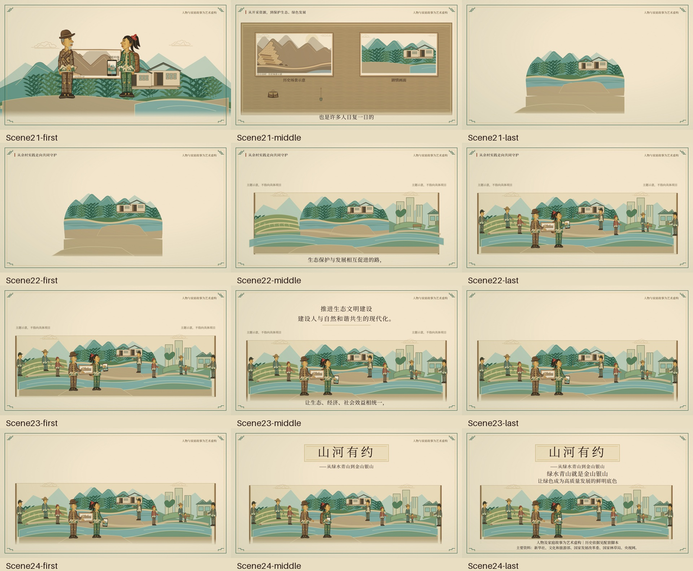

# 第六幕《山河有约》制作与接手报告

完成日期：2026-11-01。依据正式Word第六幕及声音定稿、`shots.json`的Scene21–24制作。四镜视觉Demo、代码、字幕、原创环境音、关键帧及实际MP4检查已完成。本次用户追加授权完成后上传GitHub，发布到`project/shanhe-youyue`，不合并主分支。

## 视频与画面

[第六幕MP4](../../videos/act06/Act06Demo.mp4) · [本幕SRT](../../videos/act06/Act06Demo.srt) · [全片250–300秒SRT](../../videos/act06/Act06Demo-global.srt) · [实际媒体验证](verification.json)

1920×1080／16:9／30fps，视频轨严格50秒、1500帧，H.264／yuv420p／BT.709，AAC双声道48kHz。文件7,586,748字节，约7.24MiB，SHA-256：`80547f78f3f1de139d7f7f29a6fd1669e5a97b63b46c394210e10852491e8ad3`。AAC容器50.005秒为音频封装填充，视频轨和时间轴仍严格50秒。



|镜头|本幕帧区间（不含结束边界）|全片帧区间|完成内容|
|---|---|---|---|
|Scene21 两张图之间|[0,360)|[7500,7860)|第五幕同源末帧接纸边；旧矿山与今日山水并置；工具包、铲子、民宿钥匙、手机依次回扣，村民与物件连接；沿河流进入长卷|
|Scene22 从一个村庄望向更远|[360,720)|[7860,8220)|长卷左右展开；远山、竹林梯田、余村、城市绿地和清洁生产主题意象分层；明确标注“主题示意，不指向具体项目”|
|Scene23 山河与生活同在|[720,1110)|[8220,8610)|同卷继续；劳动、经营、出游生活节点；窗灯暖起，小禾放低手机；两行原文主题文字|
|Scene24 山河有约|[1110,1500)|[8610,9000)|爷孙约定、收旧图、轻微抬头；片名、副标题、两行主题及完整资料来源；最后60帧定格|

12张首／中／末图在[keyframes/](keyframes/)。六张[实际MP4动作截帧](details/)分别检查四物件、长卷、放低手机、收图、片名和最终版式。

## 同源素材与美术规范

继续使用第一幕`Puppet`的现实老周与小禾、第二幕`Villager`及第四／第五幕生活群像。保留灰发帽须、红发饰马尾、服饰纹样、皮革色和铆钉；没有新设计主角、重绘原PNG或声称原图已完成精细拆骨骼。手臂使用既有`armTo`／`handPoint`绑定道具，动作克制，不拉伸整张人物图。

旧图直接复用开场`OldPrint`／`MountainScene`；今日图复用第五幕`AlignedLandscape`。两图使用相同取景框与主山脊坐标，取消今日舞台的位移后对齐；左图为“历史场景示意”，右图为“剧情画面”。不把虚构家庭故事包装成史料。

复用生态配色：宣纸`#F2E5CB`、森林绿`#315D45`、玉绿`#6A9B8B`、天空`#A8C9C2`、土色`#8A6849`、金色`#C79540`；主体文字沿用墨褐`#2D1E1B`。纸纹与轮廓沿用既有组件，不添加写实、霓虹或粒子特效。

长卷的远山、竹田、余村、绿地／清洁生产、连续河流为独立SVG层，轻微视差和缓入缓出；余村保留中心定位，左右只是主题意象，无新历史事件、真实城市或企业项目、收益统计。村民按管护、农作、经营与步行分散，避免庆典式排队。

全部中文为真实文字，复用随仓库分发的宋体。对白仍为`Dialogue formal`：44px，左右120px，底部78px及160px宣纸承托。片尾片名100px，副标题36px，主题48／42px，虚构说明31px、来源30px，分层放置。Scene24对白结束后6.5–6.9秒收起底部字幕承托，让来源完整可读。

## 代码结构与复用接口

以下路径以`red-paper-reborn/`为根：

|文件／接口|职责|
|---|---|
|`src/components/act06/Act06Frame.tsx`|统一舞台、字幕、标签、虚构提示和50秒环境音分段；接`scene`、可选`label`／`labelOpacity`|
|`src/components/act06/Photos.tsx`|`PhotoPair()`同山脊双图；`MemoryObjects({time})`四道具及手部绑定|
|`src/components/act06/Scroll.tsx`|`ScrollBackdrop({time,expand,light,notes,noteOpacity})`，展开和光照0–1；`ScrollPeople({time,opacity})`生活群像|
|`src/components/act06/FinalPair.tsx`|`FinalPair({lower,pack,look})`，0–1控制放低手机、收图与抬头|
|`src/scenes/act06/Scene21.tsx`–`Scene24.tsx`|四镜局部时间轴、遮罩、镜头和片尾文字|
|`src/scenes/act06/captions.json`|11段准确字幕，局部毫秒时间|
|`src/compositions/Act06Demo.tsx`|12／12／13／13秒的Series合成|
|`src/compositions/FullFilmPreview.tsx`|直接复用六幕组件的300秒总预览，不改写或重新编码旧MP4|
|`src/Root.tsx`|注册第六幕、四个独立Scene及FullFilmPreview|
|`scripts/render-act06.mjs`|关键帧、额外动作帧、总片边界检查或独立幕视频渲染|
|`scripts/verify-act06.mjs`|脚本时长、原文、配音窗口、音轨规格、既有文件保护；生成两份SRT|
|`scripts/inspect-act06-media.py`|完整实际媒体解码、黑白帧扫描、静止像素、六幕规格与总时长检查|
|`scripts/create-act06-foley.py`|Python标准库生成原创非人声环境音|

新增代码内SVG为桌面双图布局、河流遮罩、长卷纸轴与边缘、竹田／绿地／清洁生产意象、窗灯及片尾文字层。工具包、铲子、钥匙、手机、手、山脊及房屋均复用原组件，没有新增AI图像或视频。

## 原文与声音窗口

窗口均为各Scene内部秒数。对白逐字来自Word，按阅读节奏拆成11段，没有改写。

|镜头／说话者|时间|原文|
|---|---|---|
|21 旁白|0.6–11.3|两张图之间，是一次次选择，也是许多人日复一日的守护与创造。|
|22 旁白|0.6–11.5|从一个村庄望向更远，生态保护与发展相互促进的路，还需要更多人一起走。|
|23 旁白|0.7–12.0|推进生态文明建设，让生态、经济、社会效益相统一，建设人与自然和谐共生的现代化。|
|24 小禾|0.7–4.2|爷爷，明年还来这里拍。|
|24 老周|4.5–6.5|好，山河有约。|

Scene23屏幕主题为“推进生态文明建设”“建设人与自然和谐共生的现代化。”。Word屏幕文字栏给出4–13秒，动作说明另写9–13秒；本版遵照屏幕文字栏，从4秒淡入，12.45秒开始收起以连接片尾，没有改动文字。

片尾从Scene24第5秒进入“山河有约”“——从绿水青山到金山银山”；第7秒进入“绿水青山就是金山银山”“让绿色成为高质量发展的鲜明底色”，并显示：

> 人物及家庭故事为艺术虚构｜历史依据见配套脚本
>
> 主要资料：新华社、文化和旅游部、国家发展改革委、国家林草局、央视网。

`public/assets/audio/act06-foley.wav`为50秒、48kHz、16bit双声道PCM，固定随机种子20261105，源峰值约−25.31dBFS、场景音量0.8。含纸响、风、水、低声生活氛围及少量原创器乐音，结尾淡出。实际AAC解码峰值−28.29dBFS，没有削波。无TTS、人声模仿、历史录音、下载采样、付费API或商业音乐。正式旁白、爷孙真人对白和全片统一混音待制作。

## 运行和检查

在工程目录安装锁定依赖后：

```sh
pnpm run dev
pnpm run lint
pnpm run check:project
pnpm run check:portable
pnpm run check:act06
pnpm run keyframes:act06
pnpm run render:act06
node scripts/render-act06.mjs extras
node scripts/render-act06.mjs full-check
python scripts/inspect-act06-media.py
```

Studio选择`Act06Demo`（通常为`http://localhost:3000/Act06Demo`），或`FullFilmPreview`查看300秒总时间轴。已实际播放第六幕、检查1500帧规格及无Studio错误，并打开总预览确认9000帧及第8999帧。

本地输出为`red-paper-reborn/out/act06/Act06Demo.mp4`，SRT及检查中间图在同目录；`out/`与渲染浏览器包继续忽略。仓库发布版在`videos/act06/`，按字节复制，没有二次压缩。

已完成代码规范、TypeScript、主Word来源／24镜规划和三帧便携字体检查。实际视频和完整音轨解码通过；1500帧缩小到160×90扫描，未出现99%以上纯黑或纯白帧。首中末12帧、额外动作帧及实际MP4截帧均检查，结果见`verification.json`。

第20镜末帧与第21镜首帧使用同源场景，像素差为0。第21／22镜河流遮罩衔接、第22／23镜共用长卷与人物锚点、第23／24镜同一40px景物偏移和放低手机姿态均检查。总预览在各幕边界及片尾共14个帧位置完成渲染检查；这不是9000帧完整视频解码。

最终画面在Scene24局部第330帧开始锁定所有视觉时钟，对应第六幕[1440,1500)、全片[8940,9000)。独立渲染1440／1470／1499及总预览8940／8999帧RGB哈希完全相同；实际H.264末60帧逐帧解码后最大平均RGB差仅0.011053／255，为编码量化差，源动画完全静止。最后有效帧是8999，没有追加黑尾或片尾时长。

## 全片状态与下一步

六幕均已具备独立MP4，视频轨合计40＋50＋50＋50＋60＋50＝300秒、9000帧，规格一致。原工程没有统一总入口，本次补充`FullFilmPreview`，直接引用六幕进行总片预览。尚未导出单个300秒MP4，不将预览通过写成整片最终声音验收。

可以进入统一配音、字幕校时、美术审片及最终混音／总片导出阶段。录音进入后须复核分句阅读速度、跨幕环境音和转场观感；人物细密纹样可按既有素材标准精修。没有阻止现有工程运行、预览和第六幕导出的已知问题。

开发前建立240项旧幕代码／素材／成品哈希基线，制作与实际媒体验证时全部不变。发布时只允许更新总视频说明与总清单两项索引，原基线另存，所有旧源码、原PNG、MP4、SRT均保持。主分支和旧归档不受影响，发布详情见[第六幕发布记录](../第六幕发布记录.md)。
