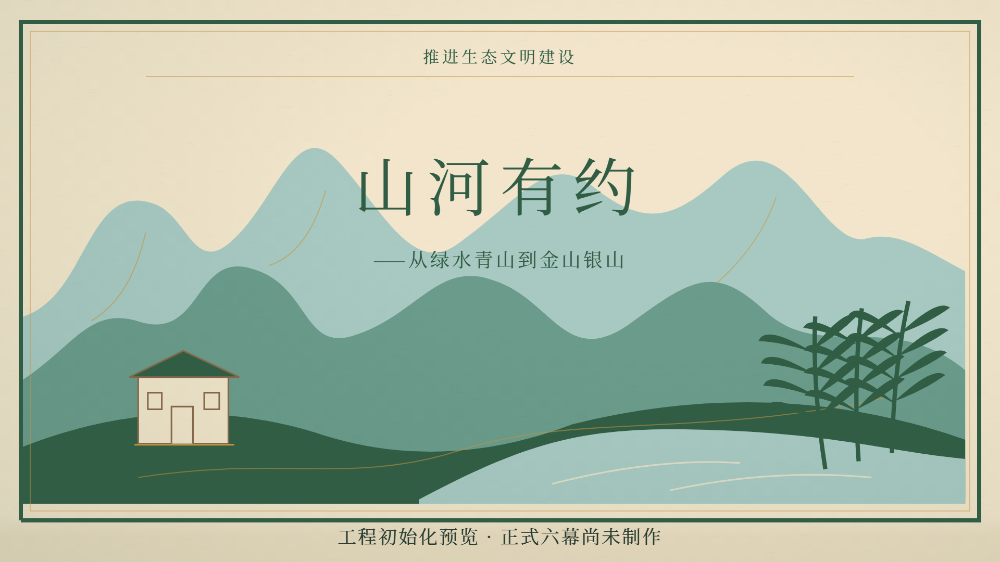

# 《山河有约》仓库迁移报告

日期：2026-10-31。迁移范围为安全归档、工程/资料初始化及待审阅PR，不是五分钟正式动画开发。

## 旧项目保护

origin保持 https://github.com/P1chyTT/MaoGai-video.git ，原默认分支master保持不变。所有下列归档已真实推送，并用ls-remote逐项验证指向；没有改写旧提交或强推。

|备份|来源提交|远程入口|
|---|---|---|
|archive/hongzhi-xinsheng|4159effcab0098cc86aff45e818d5c12bd167c6f|[旧主线](https://github.com/P1chyTT/MaoGai-video/tree/archive/hongzhi-xinsheng)|
|hongzhi-xinsheng-final（注释标签）|同旧主线|[标签](https://github.com/P1chyTT/MaoGai-video/tree/hongzhi-xinsheng-final)|
|archive/hongzhi-xinsheng-collaboration|11231a218c8c685ecf1966d7728d1f39af23e07d|[队友配音及第五幕工程](https://github.com/P1chyTT/MaoGai-video/tree/archive/hongzhi-xinsheng-collaboration)|
|archive/hongzhi-xinsheng-act04|717ff203753fdd3de768653ac4d15fb1062ac4bc|[第四幕分支快照](https://github.com/P1chyTT/MaoGai-video/tree/archive/hongzhi-xinsheng-act04)|
|archive/hongzhi-xinsheng-act05|864869efb969f6958eb4ee6a57f9db076af8f61b|[第五幕分支快照](https://github.com/P1chyTT/MaoGai-video/tree/archive/hongzhi-xinsheng-act05)|

标签名称沿用迁移要求，不表示旧片已完成声音与导演验收。队友原分支和旧PR没有合并、关闭或改写。恢复时可使用另一个干净工作目录检出任一archive分支；先保存当前未提交内容，不在本目录强制切换或清理。

## 新项目与文件整理

新分支：project/shanhe-youyue，从origin/master建立，不在归档上开发。保留red-paper-reborn工程路径；React19.2.3、TypeScript5.9.3、Remotion4.0.537及pnpm锁定依赖不升级。

- README、项目元信息、预览Root、导出、CI、贡献/接手规则全部切换为山河有约。
- 保留帧缓动、字幕时间机制、宣纸舞台技术、纸纹与合法思源宋体；主题条从旧故事中独立抽取。旧角色、对白、专属分镜与成片不再进入新项目打包。
- 已建立六幕目录，以及老周、小禾、群像、矿山、村庄、山水、河流、竹林和音频资产位置。目录待素材，不绘制替代角色。
- 已找到并按字节复制主Word，收录用户明确确认的创作程序与shots.json。原.codex-yucun-script目录未移动或删除；仓库副本在docs/视频脚本/源码，仅将个人绝对路径改为便携配置，来源记录保存前后哈希。未执行其Word生成程序，也未自行编写完整新剧本。
- 清理清单在执行前形成，完整逐文件记录见cleanup-manifest.json；操作只针对已跟踪旧故事文件，没有递归删除未知目录、node_modules或未跟踪内容。

## 运行检查结果

|检查|结果|
|---|---|
|锁定依赖安装|pnpm11.25.0 frozen-lockfile／hoisted成功；配置与版本不升级|
|ESLint和TypeScript|通过|
|主Word来源、24镜时间轴|通过：六幕40/50/50/50/60/50秒，连续300秒9000帧；24镜全部待制作|
|旧角色/故事引用检查|新src未引用旧PNG或旧项目入口|
|中文与跨平台字体|0/75/149三帧渲染成功，使用仓库内思源宋体|
|Studio|http://localhost:3000/TechnicalPreview 已打开，错误层为null|
|实际导出|1920×1080、30fps、5秒／150帧技术预览成功；ffprobe解码计数150|
|缺失素材|正式老周、小禾、群像及配音/正式场景待制作；初始化预览没有缺失资源错误|

初始化MP4本机路径为red-paper-reborn/out/initialization/TechnicalPreview.mp4，大小431,763字节，SHA-256为cd64343ab35b6b2a0c64ab71eb3c54b6bba470245bee69f7c3b6149cfbf06c25。生成输出默认忽略，只提交[一张技术预览证据](initialization-preview.png)和[参数检查记录](verification.json)，不把临时包与全部帧塞入Git。

Git LFS 3.7.1可用，当前无LFS跟踪规则；新项目没有最终成片，也没有新增超过50MiB的文件，因此未改写.gitattributes、购买配额或迁移旧视频历史。未来最终MP4超过阈值时，先核对配额/权限，再选择LFS或Releases。当前正式成片位置：尚无。

## GitHub审阅与后续

新分支已成功推送：[project/shanhe-youyue](https://github.com/P1chyTT/MaoGai-video/tree/project/shanhe-youyue)。

迁移PR已创建：[PR #3 · Replace Hongzhi Xinsheng with Shanhe Youyue project](https://github.com/P1chyTT/MaoGai-video/pull/3)，目标master，当前开放、未合并。需要用户审阅确认后再合并。本次没有修改GitHub默认分支。

用户确认前不合并PR、不更改默认分支。PR未合并期间，master首页仍属于旧项目，新项目资料应在开发分支查看。

下一阶段：确认主稿与史实来源；设计新人物及矿山/村庄/山水视觉；认领第一幕风格样片；再逐幕制作、录音校时与验收。正式完成数0/24，不能以5秒技术检查替代成片进度。
